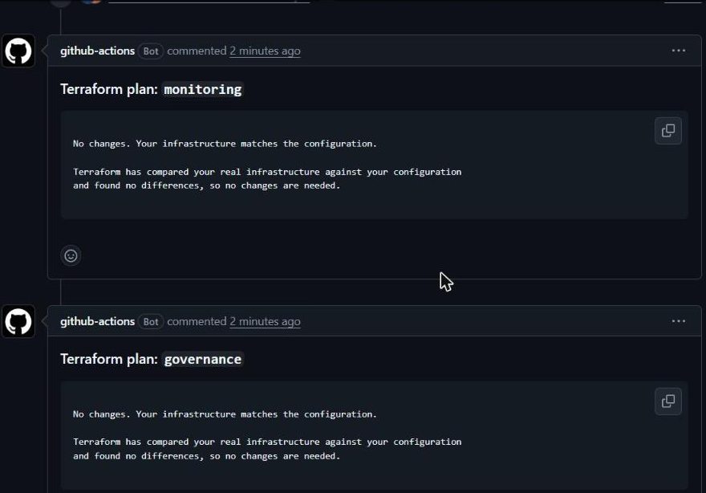
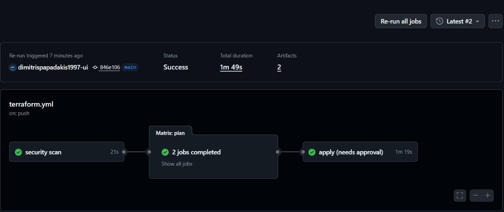

# Azure CI/CD & Monitoring with Terraform

A GitHub Actions pipeline for Terraform on Azure, with security scanning, an approval gate for production, monitoring alerts, drift detection and a cost guard rail. Authentication uses OIDC, so no secret is stored in GitHub. The state lives in Azure Storage and is shared with the sibling project [azure-network-foundation](https://github.com/dimitrispapadakis1997-ui/azure-network-foundation).

**Status:** ✅ Complete. See [docs/progress-log.md](docs/progress-log.md) for what went wrong along the way.

## How the pipeline works

`.github/workflows/terraform.yml` runs on every pull request and on every push to `main` that touches `envs/`:

1. **Security scan.** Checkov scans the Terraform code. A finding fails the run before anything is planned.
2. **Plan.** Both environments (`governance`, `monitoring`) are checked with `terraform fmt`, `init`, `validate` and `plan`. On a pull request the plan is posted as a comment, so the change can be reviewed before merge.
3. **Apply.** Only on `main`, and only after a manual approval in the `production` GitHub environment. It applies the exact plan file produced in step 2, so what gets applied is what was reviewed.

`.github/workflows/drift.yml` runs every morning and on demand. It plans each environment and fails if real infrastructure no longer matches the code.

## What it looks like

The plan posted as a comment on a pull request:

A run on `main`: security scan, plans for both environments, then the apply that waited for approval:

## What it manages

- **`envs/governance`**: a monthly subscription budget (NOK 200) with email alerts at 50% and 90% of actual spend and when the forecast passes 100%.
- **`envs/monitoring`**: an action group that emails the owner, plus two activity log alerts: a resource group was deleted, and an Azure service health incident or maintenance.

## How it authenticates

The workflow requests a short-lived OIDC token from GitHub and exchanges it for an Azure token. The app registration has one federated credential per trigger: pull request, `main`, and the `production` environment. Setup steps are in [docs/bootstrap.md](docs/bootstrap.md).

## Cost

The subscription is a free account with a limited credit and is never upgraded to pay-as-you-go, so Azure cannot charge a card. Everything here is free or near free, and the budget is the second layer: it warns before the credit is gone.

## How this was built

I built this with an AI assistant (Claude) to speed up writing code and documentation. I chose the design, set the constraints (cost, security, approval gate), approved the production deployments, and checked the results in Azure and GitHub. The progress log records the problems that came up and how they were fixed.
